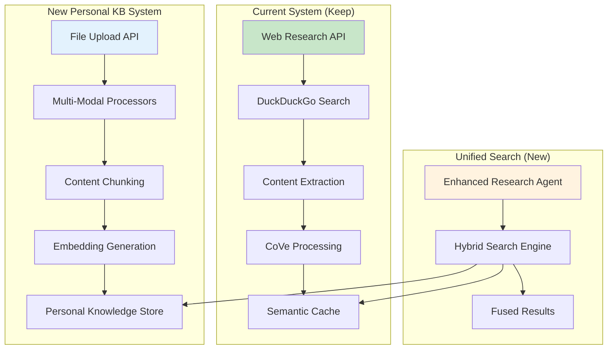
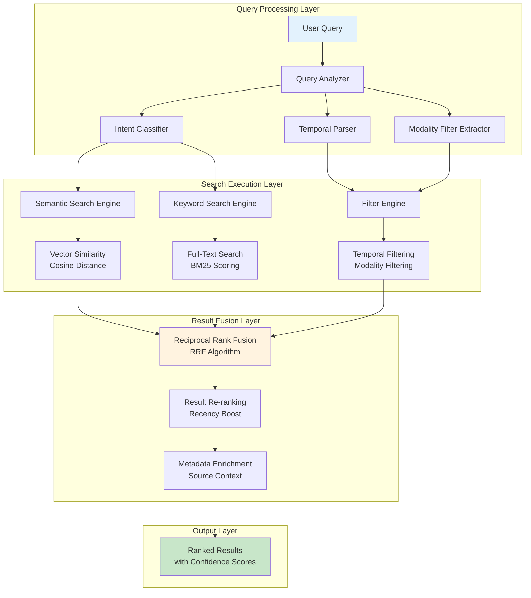
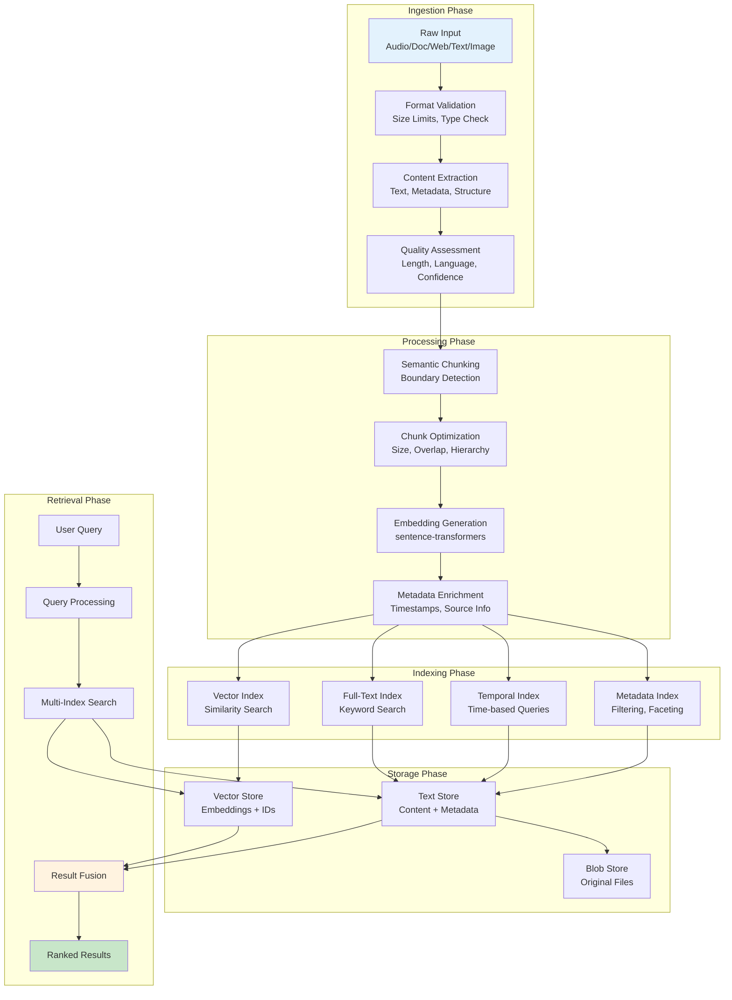
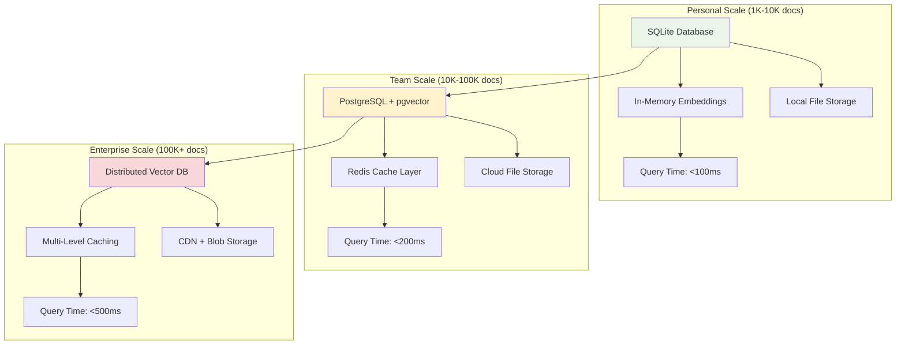
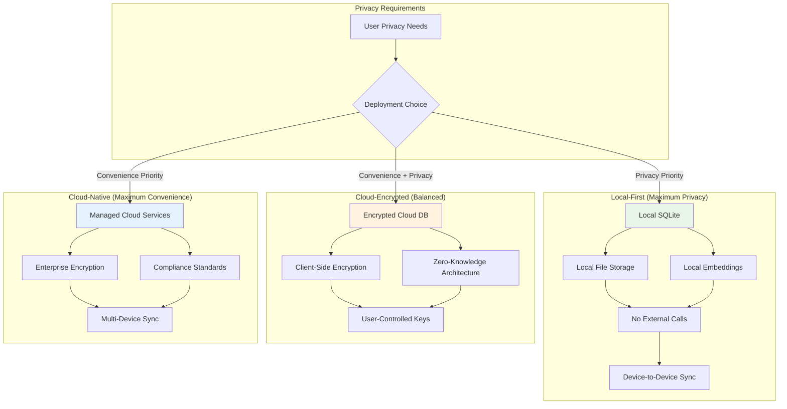

# Personal Knowledge Brain - System Design (Extension Plan)

## Executive Summary

This document outlines how to extend the existing Deep Research Agent into a Personal Knowledge Brain system. Rather than rebuilding from scratch, this design leverages the current FastAPI + Gemini + semantic caching architecture and adds personal data ingestion, indexing, and retrieval capabilities.

**Current System Analysis:**
- ✅ **FastAPI Framework**: Robust async API with rate limiting, validation, and error handling
- ✅ **Gemini LLM Integration**: Working Chain-of-Verification (CoVe) methodology with retry logic
- ✅ **Web Search Service**: DuckDuckGo integration with content extraction and caching
- ✅ **Semantic Caching**: Cosine similarity-based caching with TTL and eviction
- ✅ **Fact Checking**: Cross-reference verification with confidence scoring
- ✅ **Safeguards**: Circuit breakers, rate limiting, concurrent request management

**Extension Strategy:**
- **Minimal Disruption**: Add new services alongside existing ones
- **Reuse Patterns**: Extend existing retry logic, async patterns, and error handling
- **Progressive Enhancement**: Start with basic features, add complexity incrementally
- **Backward Compatibility**: Maintain all existing research functionality

---

## 1. What's Already Built vs What Needs Adding

### 1.1 Current System Capabilities

**Existing Infrastructure (Keep & Extend):**

| Component | Current Implementation | Status | Extension Needed |
|-----------|----------------------|---------|------------------|
| **API Framework** | FastAPI with async, CORS, validation | ✅ Complete | Add file upload endpoints |
| **LLM Integration** | Gemini 2.5 Flash with retry logic | ✅ Complete | Add OpenAI Whisper for audio |
| **Web Search** | DuckDuckGo + BeautifulSoup extraction | ✅ Complete | Extend for personal URL ingestion |
| **Semantic Caching** | Cosine similarity with TTL | ✅ Complete | Extend for personal content |
| **Content Processing** | Web page text extraction | ✅ Complete | Add document/audio processors |
| **Fact Checking** | Cross-reference verification | ✅ Complete | Extend for personal content |
| **Error Handling** | Circuit breakers, rate limiting | ✅ Complete | Reuse patterns |
| **Configuration** | Environment-based config | ✅ Complete | Add KB-specific settings |

**Current Data Flow (Working):**
```
User Query → Rate Limiting → Semantic Cache Check → Web Search → 
Content Extraction → CoVe Processing → Fact Checking → Response
```

### 1.2 What Needs to be Added

**New Components Required:**

1. **Personal Content Storage**
   - SQLite database for local deployment
   - Document/chunk tables with embeddings
   - Temporal indexing for time-based queries

2. **Multi-Modal Processors**
   - Audio processor (Whisper API integration)
   - Document processor (PyMuPDF for PDFs)
   - Image processor (GPT-4 Vision for descriptions)
   - Text processor (direct ingestion)

3. **Enhanced Search Engine**
   - Hybrid search (semantic + keyword)
   - Temporal query parsing
   - Personal + web result fusion

4. **New API Endpoints**
   - File upload endpoints
   - Personal knowledge search
   - Content management (list, delete)

**Extension Strategy:**
- **Phase 1**: Add basic document ingestion and search
- **Phase 2**: Add audio processing and temporal queries  
- **Phase 3**: Add image processing and advanced features

---

## 2. Multi-Modal Data Ingestion Pipeline (New Addition)

### 2.1 Pipeline Architecture - Extending Current System

The ingestion pipeline adds personal content processing alongside the existing web research capabilities. It reuses current patterns for consistency and reliability.

**Integration with Existing System:**



### 2.2 Extending Existing Services

**Building on Current Web Search Service:**

```python
# services/web_search.py (Extend existing class)
class WebSearchService:
    # ... existing methods for research ...
    
    async def ingest_personal_url(self, url: str, user_id: str) -> str:
        """
        NEW METHOD: Ingest URL for personal knowledge base
        Reuses existing fetch_content method
        """
        # Reuse existing content fetching logic
        content = await self.fetch_content(url)
        
        if not content or len(content) < 100:
            raise ValueError(f"Could not extract sufficient content from {url}")
        
        # Create chunks using existing patterns
        chunks = self._create_web_chunks(content, url)
        
        # Store in personal knowledge base (new)
        doc_id = await self._store_personal_content(chunks, {
            "modality": "web",
            "url": url,
            "title": self._extract_title(url),
            "ingested_at": datetime.utcnow().isoformat()
        }, user_id)
        
        return doc_id
    
    def _create_web_chunks(self, content: str, source_url: str) -> List[dict]:
        """Create chunks from web content (reuse existing logic)"""
        # Split content into paragraphs (existing pattern)
        paragraphs = [p.strip() for p in content.split('\n\n') if p.strip()]
        
        chunks = []
        current_chunk = ""
        chunk_index = 0
        
        for paragraph in paragraphs:
            if len(current_chunk) + len(paragraph) > 800 and current_chunk:
                chunks.append({
                    "content": current_chunk.strip(),
                    "chunk_index": chunk_index,
                    "source_url": source_url
                })
                chunk_index += 1
                current_chunk = paragraph + "\n\n"
            else:
                current_chunk += paragraph + "\n\n"
        
        if current_chunk.strip():
            chunks.append({
                "content": current_chunk.strip(),
                "chunk_index": chunk_index,
                "source_url": source_url
            })
        
        return chunks
```

**Extending Existing Semantic Cache:**

```python
# services/semantic_cache.py (Extend existing class)
class SemanticCache:
    # ... existing research caching methods ...
    
    async def search_personal_content(self, query: str, user_id: str) -> List[dict]:
        """
        NEW METHOD: Search personal content using existing similarity logic
        """
        # Reuse existing embedding generation
        query_embedding = self._simple_embedding(query)
        
        # Get personal content embeddings (new storage)
        personal_embeddings = await self._get_personal_embeddings(user_id)
        
        results = []
        for content_id, embedding in personal_embeddings.items():
            # Reuse existing cosine similarity calculation
            similarity = self._cosine_similarity(query_embedding, embedding)
            
            if similarity >= self.similarity_threshold:
                results.append({
                    "content_id": content_id,
                    "similarity": similarity,
                    "metadata": await self._get_content_metadata(content_id)
                })
        
        return sorted(results, key=lambda x: x["similarity"], reverse=True)
```

---

## 3. Enhanced API Design (Extending Current Endpoints)

### 3.1 New Endpoints to Add

**Building on Existing main.py Structure:**

```python
# main.py (Add these new endpoints to existing file)

# Add new imports
from fastapi import UploadFile, File
from services.knowledge_store import KnowledgeStore
from services.audio_processor import AudioProcessor
from services.document_processor import DocumentProcessor
from services.text_processor import TextProcessor
from services.image_processor import ImageProcessor

# Initialize new services (add to existing initialization)
knowledge_store = KnowledgeStore()
audio_processor = AudioProcessor()
document_processor = DocumentProcessor()
text_processor = TextProcessor()
image_processor = ImageProcessor()

# NEW ENDPOINTS (add to existing app)

@app.post("/knowledge/ingest/audio")
async def ingest_audio(
    file: UploadFile = File(...),
    user_id: str = "default",
    req: Request = None
):
    """Upload and process audio file for personal knowledge base"""
    # Reuse existing rate limiting pattern
    client_ip = req.client.host if req.client else "unknown"
    if not rate_limiter.is_allowed(client_ip):
        raise HTTPException(429, "Rate limit exceeded")
    
    try:
        # Validate file type
        if not file.filename.lower().endswith(('.mp3', '.m4a', '.wav', '.ogg')):
            raise HTTPException(400, "Unsupported audio format")
        
        # Save uploaded file temporarily
        temp_path = f"/tmp/{file.filename}"
        with open(temp_path, "wb") as f:
            content = await file.read()
            f.write(content)
        
        # Process using new audio processor
        result = await audio_processor.process_audio(temp_path, user_id)
        
        # Store in knowledge base
        doc_id = await knowledge_store.store_content(result, user_id)
        
        # Clean up temp file
        os.unlink(temp_path)
        
        return {"status": "success", "document_id": doc_id, "chunks": len(result.chunks)}
        
    except Exception as e:
        raise HTTPException(500, f"Processing error: {str(e)}")

@app.post("/knowledge/ingest/document")
async def ingest_document(
    file: UploadFile = File(...),
    user_id: str = "default",
    req: Request = None
):
    """Upload and process document for personal knowledge base"""
    client_ip = req.client.host if req.client else "unknown"
    if not rate_limiter.is_allowed(client_ip):
        raise HTTPException(429, "Rate limit exceeded")
    
    try:
        # Validate file type
        if not file.filename.lower().endswith(('.pdf', '.md', '.txt', '.docx')):
            raise HTTPException(400, "Unsupported document format")
        
        # Save and process
        temp_path = f"/tmp/{file.filename}"
        with open(temp_path, "wb") as f:
            content = await file.read()
            f.write(content)
        
        result = await document_processor.process_document(temp_path, user_id)
        doc_id = await knowledge_store.store_content(result, user_id)
        
        os.unlink(temp_path)
        
        return {"status": "success", "document_id": doc_id, "chunks": len(result.chunks)}
        
    except Exception as e:
        raise HTTPException(500, f"Processing error: {str(e)}")

@app.post("/knowledge/ingest/url")
async def ingest_url(
    url: str,
    user_id: str = "default",
    req: Request = None
):
    """Ingest web page URL for personal knowledge base"""
    client_ip = req.client.host if req.client else "unknown"
    if not rate_limiter.is_allowed(client_ip):
        raise HTTPException(429, "Rate limit exceeded")
    
    try:
        # Reuse existing web search service
        result = await web_search.ingest_personal_url(url, user_id)
        doc_id = await knowledge_store.store_content(result, user_id)
        
        return {"status": "success", "document_id": doc_id, "url": url}
        
    except Exception as e:
        raise HTTPException(500, f"Processing error: {str(e)}")

@app.post("/knowledge/ingest/text")
async def ingest_text(
    text: str,
    title: str = None,
    user_id: str = "default",
    req: Request = None
):
    """Ingest plain text for personal knowledge base"""
    client_ip = req.client.host if req.client else "unknown"
    if not rate_limiter.is_allowed(client_ip):
        raise HTTPException(429, "Rate limit exceeded")
    
    try:
        result = await text_processor.process_text(text, user_id, title)
        doc_id = await knowledge_store.store_content(result, user_id)
        
        return {"status": "success", "document_id": doc_id, "chunks": len(result.chunks)}
        
    except Exception as e:
        raise HTTPException(500, f"Processing error: {str(e)}")

@app.post("/knowledge/search")
async def search_knowledge(
    query: str,
    user_id: str = "default",
    include_web: bool = False,
    temporal_filter: Optional[str] = None,
    limit: int = 10
):
    """
    Search personal knowledge base with optional web research
    (extends existing /research endpoint pattern)
    """
    try:
        if include_web:
            # Use enhanced research agent for unified search
            enhanced_agent = EnhancedResearchAgent()
            results = await enhanced_agent.unified_research(
                query, user_id, include_personal=True, include_web=True
            )
        else:
            # Search only personal content
            results = await knowledge_store.search_similar(query, user_id, limit=limit)
        
        return {
            "query": query,
            "results": results,
            "metadata": {
                "search_type": "unified" if include_web else "personal",
                "temporal_filter": temporal_filter,
                "result_count": len(results)
            }
        }
        
    except Exception as e:
        raise HTTPException(500, f"Search error: {str(e)}")

@app.get("/knowledge/documents")
async def list_documents(
    user_id: str = "default",
    modality: Optional[str] = None,
    limit: int = 50
):
    """List user's documents with optional filtering"""
    try:
        documents = await knowledge_store.list_user_documents(
            user_id, modality=modality, limit=limit
        )
        
        return {
            "documents": documents,
            "total": len(documents),
            "modality_filter": modality
        }
        
    except Exception as e:
        raise HTTPException(500, f"Error listing documents: {str(e)}")

@app.delete("/knowledge/documents/{document_id}")
async def delete_document(
    document_id: str,
    user_id: str = "default"
):
    """Delete a document and all its chunks"""
    try:
        success = await knowledge_store.delete_document(document_id, user_id)
        
        if success:
            return {"status": "deleted", "document_id": document_id}
        else:
            raise HTTPException(404, "Document not found or access denied")
        
    except Exception as e:
        raise HTTPException(500, f"Error deleting document: {str(e)}")

# EXTEND EXISTING ENDPOINTS

@app.get("/cache/stats")
async def enhanced_cache_stats():
    """Enhanced cache statistics including personal knowledge"""
    # Get existing research cache stats
    research_stats = research_agent.semantic_cache.get_stats()
    
    # Get personal knowledge stats
    kb_stats = await knowledge_store.get_stats()
    
    return {
        "research_cache": research_stats,
        "personal_knowledge": kb_stats,
        "config": {
            "similarity_threshold": Config.CACHE_SIMILARITY_THRESHOLD,
            "vector_threshold": getattr(Config, 'VECTOR_SIMILARITY_THRESHOLD', 0.7),
            "max_file_size_mb": getattr(Config, 'MAX_FILE_SIZE_MB', 50)
        }
    }
```

### 3.2 Configuration Extensions

**Add to config.py:**

```python
# config.py (Add these to existing Config class)
class Config:
    # ... existing configuration ...
    
    # Personal Knowledge Brain Settings
    KNOWLEDGE_DB_PATH = os.getenv("KNOWLEDGE_DB_PATH", "knowledge.db")
    ENABLE_PERSONAL_KB = os.getenv("ENABLE_PERSONAL_KB", "true").lower() == "true"
    MAX_FILE_SIZE_MB = int(os.getenv("MAX_FILE_SIZE_MB", 50))
    
    # OpenAI API for Whisper and Vision (optional)
    OPENAI_API_KEY = os.getenv("OPENAI_API_KEY", "")
    
    # Vector Search Settings
    EMBEDDING_MODEL = os.getenv("EMBEDDING_MODEL", "all-MiniLM-L6-v2")
    VECTOR_SIMILARITY_THRESHOLD = float(os.getenv("VECTOR_SIMILARITY_THRESHOLD", 0.7))
    
    # Temporal Query Settings
    ENABLE_TEMPORAL_QUERIES = os.getenv("ENABLE_TEMPORAL_QUERIES", "true").lower() == "true"
    
    # File Upload Settings
    UPLOAD_DIR = os.getenv("UPLOAD_DIR", "/tmp/uploads")
    BLOB_STORAGE_DIR = os.getenv("BLOB_STORAGE_DIR", "./data/blobs")
```

### 3.3 Database Schema (Simple SQLite Start)

**Create services/knowledge_store.py:**

```python
# services/knowledge_store.py (New service)
import sqlite3
import json
import uuid
from datetime import datetime
from typing import List, Dict, Optional, Any
from sentence_transformers import SentenceTransformer
import numpy as np

class KnowledgeStore:
    """Simple knowledge storage building on existing patterns"""
    
    def __init__(self, db_path: str = None):
        self.db_path = db_path or Config.KNOWLEDGE_DB_PATH
        self.embedding_model = SentenceTransformer(Config.EMBEDDING_MODEL)
        self._init_database()
    
    def _init_database(self):
        """Initialize SQLite database with schema"""
        conn = sqlite3.connect(self.db_path)
        conn.executescript("""
            -- Documents table (parent container for all content)
            CREATE TABLE IF NOT EXISTS documents (
                id TEXT PRIMARY KEY,
                user_id TEXT NOT NULL,
                modality TEXT NOT NULL CHECK (modality IN ('audio', 'document', 'web', 'text', 'image')),
                source_identifier TEXT,
                source_path TEXT,
                content_hash TEXT,
                content_timestamp TIMESTAMP,
                created_at TIMESTAMP DEFAULT CURRENT_TIMESTAMP,
                ingested_at TIMESTAMP DEFAULT CURRENT_TIMESTAMP,
                metadata TEXT,
                processing_status TEXT DEFAULT 'completed'
            );
            
            -- Chunks table (searchable content pieces)
            CREATE TABLE IF NOT EXISTS chunks (
                id TEXT PRIMARY KEY,
                document_id TEXT NOT NULL,
                content_text TEXT NOT NULL,
                chunk_index INTEGER NOT NULL,
                embedding_vector TEXT,
                hierarchy_level TEXT,
                section_title TEXT,
                content_timestamp TIMESTAMP,
                created_at TIMESTAMP DEFAULT CURRENT_TIMESTAMP,
                FOREIGN KEY (document_id) REFERENCES documents(id) ON DELETE CASCADE
            );
            
            -- Performance indexes
            CREATE INDEX IF NOT EXISTS idx_documents_user ON documents(user_id);
            CREATE INDEX IF NOT EXISTS idx_documents_modality ON documents(modality);
            CREATE INDEX IF NOT EXISTS idx_documents_created ON documents(created_at);
            CREATE INDEX IF NOT EXISTS idx_chunks_document ON chunks(document_id);
            CREATE INDEX IF NOT EXISTS idx_chunks_timestamp ON chunks(content_timestamp);
        """)
        conn.commit()
        conn.close()
    
    async def store_content(self, content: 'ProcessingResult', user_id: str) -> str:
        """Store processed content in knowledge base"""
        conn = sqlite3.connect(self.db_path)
        
        try:
            # Store document
            doc_id = str(uuid.uuid4())
            conn.execute("""
                INSERT INTO documents (id, user_id, modality, source_identifier, 
                                     source_path, content_hash, metadata)
                VALUES (?, ?, ?, ?, ?, ?, ?)
            """, (
                doc_id, user_id, content.metadata["modality"],
                content.metadata.get("source_identifier"),
                content.metadata.get("source_path"),
                content.metadata.get("content_hash"),
                json.dumps(content.metadata)
            ))
            
            # Store chunks with embeddings
            for i, chunk in enumerate(content.chunks):
                chunk_id = str(uuid.uuid4())
                
                # Generate embedding if not provided
                if hasattr(content, 'embeddings') and i < len(content.embeddings):
                    embedding = content.embeddings[i]
                else:
                    embedding = self.embedding_model.encode(chunk["content"])
                
                embedding_json = json.dumps(embedding.tolist())
                
                conn.execute("""
                    INSERT INTO chunks (id, document_id, content_text, chunk_index, 
                                      embedding_vector, hierarchy_level)
                    VALUES (?, ?, ?, ?, ?, ?)
                """, (
                    chunk_id, doc_id, chunk["content"], i, 
                    embedding_json, chunk.get("hierarchy_level", "chunk")
                ))
            
            conn.commit()
            return doc_id
            
        finally:
            conn.close()
    
    async def search_similar(self, query: str, user_id: str, limit: int = 10) -> List[dict]:
        """Search for similar content using embeddings"""
        # Generate query embedding
        query_embedding = self.embedding_model.encode(query)
        
        # Get all chunks for user
        conn = sqlite3.connect(self.db_path)
        cursor = conn.execute("""
            SELECT c.id, c.content_text, c.embedding_vector, d.modality, 
                   d.source_identifier, d.metadata, c.chunk_index
            FROM chunks c
            JOIN documents d ON c.document_id = d.id
            WHERE d.user_id = ?
        """, (user_id,))
        
        results = []
        for row in cursor.fetchall():
            chunk_id, content, embedding_json, modality, source, metadata_json, chunk_index = row
            
            try:
                # Calculate similarity (reuse existing cosine similarity logic)
                chunk_embedding = np.array(json.loads(embedding_json))
                similarity = self._cosine_similarity(query_embedding, chunk_embedding)
                
                if similarity >= Config.VECTOR_SIMILARITY_THRESHOLD:
                    metadata = json.loads(metadata_json) if metadata_json else {}
                    results.append({
                        "chunk_id": chunk_id,
                        "content": content,
                        "similarity": similarity,
                        "modality": modality,
                        "source": source,
                        "chunk_index": chunk_index,
                        "metadata": metadata
                    })
            except Exception as e:
                print(f"Error processing chunk {chunk_id}: {e}")
                continue
        
        conn.close()
        
        # Sort by similarity and return top results
        results.sort(key=lambda x: x["similarity"], reverse=True)
        return results[:limit]
    
    def _cosine_similarity(self, a: np.ndarray, b: np.ndarray) -> float:
        """Reuse existing cosine similarity calculation"""
        dot = np.dot(a, b)
        norm_a = np.linalg.norm(a)
        norm_b = np.linalg.norm(b)
        
        if norm_a == 0 or norm_b == 0:
            return 0.0
        
        return dot / (norm_a * norm_b)
    
    async def list_user_documents(self, user_id: str, modality: str = None, limit: int = 50) -> List[dict]:
        """List user's documents with optional filtering"""
        conn = sqlite3.connect(self.db_path)
        
        if modality:
            cursor = conn.execute("""
                SELECT id, modality, source_identifier, created_at, metadata
                FROM documents 
                WHERE user_id = ? AND modality = ?
                ORDER BY created_at DESC
                LIMIT ?
            """, (user_id, modality, limit))
        else:
            cursor = conn.execute("""
                SELECT id, modality, source_identifier, created_at, metadata
                FROM documents 
                WHERE user_id = ?
                ORDER BY created_at DESC
                LIMIT ?
            """, (user_id, limit))
        
        documents = []
        for row in cursor.fetchall():
            doc_id, modality, source, created_at, metadata_json = row
            metadata = json.loads(metadata_json) if metadata_json else {}
            
            documents.append({
                "id": doc_id,
                "modality": modality,
                "source": source,
                "created_at": created_at,
                "title": metadata.get("title", source or "Untitled"),
                "metadata": metadata
            })
        
        conn.close()
        return documents
    
    async def delete_document(self, document_id: str, user_id: str) -> bool:
        """Delete a document and all its chunks"""
        conn = sqlite3.connect(self.db_path)
        
        try:
            # Verify ownership
            cursor = conn.execute(
                "SELECT id FROM documents WHERE id = ? AND user_id = ?",
                (document_id, user_id)
            )
            
            if not cursor.fetchone():
                return False
            
            # Delete document (chunks will be deleted by CASCADE)
            conn.execute("DELETE FROM documents WHERE id = ?", (document_id,))
            conn.commit()
            
            return True
            
        finally:
            conn.close()
    
    async def get_stats(self) -> Dict[str, Any]:
        """Get knowledge base statistics"""
        conn = sqlite3.connect(self.db_path)
        
        # Get document counts by modality
        cursor = conn.execute("""
            SELECT modality, COUNT(*) 
            FROM documents 
            GROUP BY modality
        """)
        modality_counts = dict(cursor.fetchall())
        
        # Get total counts
        cursor = conn.execute("SELECT COUNT(*) FROM documents")
        total_docs = cursor.fetchone()[0]
        
        cursor = conn.execute("SELECT COUNT(*) FROM chunks")
        total_chunks = cursor.fetchone()[0]
        
        conn.close()
        
        return {
            "total_documents": total_docs,
            "total_chunks": total_chunks,
            "documents_by_modality": modality_counts,
            "storage_path": self.db_path
        }

# Data classes for type safety
class ProcessingResult:
    def __init__(self, chunks: List[dict], embeddings: List[np.ndarray] = None, 
                 metadata: dict = None, blob_reference: str = None):
        self.chunks = chunks
        self.embeddings = embeddings or []
        self.metadata = metadata or {}
        self.blob_reference = blob_reference
```

---

---

## 4. Implementation Roadmap

### 4.1 Phase 1: Core Extension (Minimal Viable Product)

**Goal**: Add basic personal knowledge capabilities without disrupting existing research functionality.

**Timeline**: 1-2 weeks

**Tasks**:
1. **Add SQLite storage** (`services/knowledge_store.py`)
   - Simple document and chunk tables
   - Basic embedding storage as JSON
   - User isolation

2. **Create basic processors** 
   - `services/text_processor.py` (simplest - start here)
   - `services/document_processor.py` (PDF support with PyMuPDF)
   - Extend `services/web_search.py` for personal URL ingestion

3. **Add core API endpoints**
   - `POST /knowledge/ingest/text`
   - `POST /knowledge/ingest/document` 
   - `POST /knowledge/ingest/url`
   - `POST /knowledge/search`
   - `GET /knowledge/documents`

4. **Extend configuration**
   - Add KB settings to `config.py`
   - Update `requirements.txt`

**Success Criteria**:
- Can upload and search text notes
- Can upload and search PDF documents
- Can save and search web pages
- All existing research functionality still works

### 4.2 Phase 2: Advanced Features

**Goal**: Add audio processing, temporal queries, and hybrid search.

**Timeline**: 2-3 weeks

**Tasks**:
1. **Add audio processing**
   - `services/audio_processor.py` with Whisper integration
   - `POST /knowledge/ingest/audio` endpoint
   - Audio file validation and chunking

2. **Implement temporal queries**
   - `services/temporal_parser.py` for date parsing
   - Temporal filtering in search
   - Time-based indexing optimization

3. **Create hybrid search engine**
   - Combine semantic + keyword search
   - Reciprocal rank fusion algorithm
   - Enhanced search relevance

4. **Add unified search**
   - Extend `ResearchAgent` for personal + web search
   - Combined result synthesis using existing CoVe methodology

**Success Criteria**:
- Can transcribe and search audio files
- Can query "what did I work on last month?"
- Search combines personal content with web research
- Hybrid search improves result quality

### 4.3 Phase 3: Polish and Scale

**Goal**: Add image processing, advanced features, and deployment options.

**Timeline**: 2-3 weeks

**Tasks**:
1. **Add image processing**
   - `services/image_processor.py` with GPT-4 Vision
   - Image description generation
   - Blob storage for image files

2. **Enhance user experience**
   - Document management (delete, update)
   - Search result highlighting
   - Export/import functionality

3. **Add deployment options**
   - Docker configuration
   - PostgreSQL migration path
   - Cloud deployment guide

4. **Performance optimization**
   - Query caching improvements
   - Batch processing for large uploads
   - Memory usage optimization

**Success Criteria**:
- Can upload and search images by description
- System handles 1000+ documents efficiently
- Ready for production deployment
- Complete documentation and examples

### 4.2 Dependencies to Add

**Update requirements.txt:**

```txt
# Existing dependencies (keep all)
fastapi==0.104.1
uvicorn==0.24.0
httpx==0.25.2
beautifulsoup4==4.12.2
lxml==4.9.3
tenacity==8.2.3
pydantic==2.5.0
google-generativeai==0.3.2

# New dependencies for Personal Knowledge Brain
sentence-transformers==2.2.2  # For embeddings
PyMuPDF==1.23.8              # For PDF processing
python-multipart==0.0.6      # For file uploads
openai==1.3.7                # For Whisper and Vision (optional)
python-docx==1.1.0           # For DOCX processing (optional)
Pillow==10.1.0               # For image processing
numpy==1.24.3                # For vector operations
```

### 4.3 Environment Variables to Add

**Update .env file:**

```bash
# Existing variables (keep all)
GOOGLE_API_KEY=your_gemini_api_key_here

# New Personal Knowledge Brain variables
OPENAI_API_KEY=your_openai_api_key_here  # Optional: for Whisper + Vision
KNOWLEDGE_DB_PATH=knowledge.db
ENABLE_PERSONAL_KB=true
MAX_FILE_SIZE_MB=50
EMBEDDING_MODEL=all-MiniLM-L6-v2
VECTOR_SIMILARITY_THRESHOLD=0.7
ENABLE_TEMPORAL_QUERIES=true
UPLOAD_DIR=/tmp/uploads
BLOB_STORAGE_DIR=./data/blobs
```

### 4.4 Minimal First Implementation

**Start with this simple text ingestion to validate the approach:**

```python
# services/simple_kb.py (Proof of concept)
import sqlite3
import json
from sentence_transformers import SentenceTransformer
import numpy as np

class SimpleKnowledgeBase:
    def __init__(self):
        self.db = sqlite3.connect("simple_kb.db")
        self.model = SentenceTransformer('all-MiniLM-L6-v2')
        self._init_db()
    
    def _init_db(self):
        self.db.execute("""
            CREATE TABLE IF NOT EXISTS notes (
                id INTEGER PRIMARY KEY,
                content TEXT,
                embedding TEXT,
                created_at TIMESTAMP DEFAULT CURRENT_TIMESTAMP
            )
        """)
    
    def add_note(self, content: str) -> int:
        embedding = self.model.encode(content)
        cursor = self.db.execute(
            "INSERT INTO notes (content, embedding) VALUES (?, ?)",
            (content, json.dumps(embedding.tolist()))
        )
        self.db.commit()
        return cursor.lastrowid
    
    def search(self, query: str, limit: int = 5) -> list:
        query_embedding = self.model.encode(query)
        
        cursor = self.db.execute("SELECT id, content, embedding FROM notes")
        results = []
        
        for row in cursor:
            note_id, content, embedding_json = row
            note_embedding = np.array(json.loads(embedding_json))
            
            similarity = np.dot(query_embedding, note_embedding) / (
                np.linalg.norm(query_embedding) * np.linalg.norm(note_embedding)
            )
            
            if similarity > 0.3:  # Threshold
                results.append({
                    "id": note_id,
                    "content": content,
                    "similarity": similarity
                })
        
        return sorted(results, key=lambda x: x["similarity"], reverse=True)[:limit]

# Test the concept
if __name__ == "__main__":
    kb = SimpleKnowledgeBase()
    
    # Add some notes
    kb.add_note("I learned about machine learning algorithms today")
    kb.add_note("The weather was sunny and warm")
    kb.add_note("Deep learning uses neural networks")
    
    # Search
    results = kb.search("AI and ML")
    for result in results:
        print(f"Similarity: {result['similarity']:.3f} - {result['content']}")
```

This roadmap provides a clear path to extend your existing Deep Research Agent into a Personal Knowledge Brain while maintaining all current functionality and following your established patterns. as existing Gemini integration)
        self.whisper_client = openai.OpenAI(api_key=Config.OPENAI_API_KEY)
        self.supported_formats = ['.mp3', '.m4a', '.wav', '.ogg']
    
    @retry(
        stop=stop_after_attempt(3),
        wait=wait_exponential(multiplier=1, min=1, max=10)
    )
    async def process_audio(self, file_path: str, user_id: str) -> ProcessingResult:
        """Process audio file using existing retry patterns"""
        # 1. Validate format (similar to existing query validation)
        if not self._is_supported_format(file_path):
            raise ValueError(f"Unsupported audio format")
        
        # 2. Transcribe using Whisper API
        transcript = await self._transcribe_audio(file_path)
        
        # 3. Create chunks using existing chunking logic
        chunks = self._create_audio_chunks(transcript)
        
        # 4. Generate embeddings (reuse existing embedding logic)
        embeddings = await self._generate_embeddings(chunks)
        
        return ProcessingResult(
            chunks=chunks,
            embeddings=embeddings,
            metadata={
                "duration_seconds": transcript.get("duration"),
                "language": transcript.get("language"),
                "modality": "audio"
            }
        )
```

### 3.3 Document Processing (Extending Current Content Extraction)

**Building on Existing Web Content Extraction:**
- Reuses existing BeautifulSoup + httpx patterns
- Extends current content extraction to handle files
- Maintains same error handling and timeout patterns

```python
# services/document_processor.py (New)
class DocumentProcessor:
    def __init__(self):
        # Reuse existing HTTP client patterns
        self.headers = {
            "User-Agent": "Mozilla/5.0 (Windows NT 10.0; Win64; x64) AppleWebKit/537.36"
        }
    
    async def process_document(self, file_path: str, user_id: str) -> ProcessingResult:
        """Process document using existing content extraction patterns"""
        file_type = self._detect_file_type(file_path)
        
        if file_type == "pdf":
            return await self._process_pdf(file_path)
        elif file_type == "markdown":
            return await self._process_markdown(file_path)
        else:
            raise UnsupportedFileTypeError(f"Unsupported: {file_type}")
    
    async def _process_pdf(self, file_path: str) -> ProcessingResult:
        """Extract PDF content (similar to web content extraction)"""
        import fitz  # PyMuPDF
        
        doc = fitz.open(file_path)
        text_content = ""
        
        for page in doc:
            text_content += page.get_text()
        
        # Reuse existing chunking logic from research agent
        chunks = self._create_document_chunks(text_content)
        embeddings = await self._generate_embeddings(chunks)
        
        return ProcessingResult(
            chunks=chunks,
            embeddings=embeddings,
            metadata={
                "page_count": len(doc),
                "file_type": "pdf",
                "modality": "document"
            }
        )
```

### 3.4 Web Content Ingestion (Extending Existing Web Search)

**Reusing Current Web Search Infrastructure:**
- Extends existing `WebSearchService` class
- Uses same DuckDuckGo + content extraction patterns
- Maintains existing caching and retry logic

```python
# Extend services/web_search.py
class WebSearchService:
    # ... existing methods ...
    
    async def ingest_url(self, url: str, user_id: str) -> ProcessingResult:
        """
        Ingest single URL for personal knowledge base
        (extends existing fetch_content method)
        """
        # Reuse existing content fetching
        content = await self.fetch_content(url)
        
        if not content:
            raise ContentExtractionError(f"Could not extract content from {url}")
        
        # Create chunks for personal storage
        chunks = self._create_web_chunks(content, url)
        embeddings = await self._generate_embeddings(chunks)
        
        return ProcessingResult(
            chunks=chunks,
            embeddings=embeddings,
            metadata={
                "url": url,
                "domain": urlparse(url).netloc,
                "fetch_timestamp": datetime.utcnow().isoformat(),
                "modality": "web"
            }
        )
```

---

## 4. Information Retrieval & Querying Strategy

### 4.1 Hybrid Search Engine (Extending Existing Semantic Cache)

**Building on Current Semantic Cache:**
- Extends existing `SemanticCache` class for personal content
- Uses same cosine similarity calculations
- Maintains existing caching patterns and TTL logic

```python
# Extend services/semantic_cache.py
class PersonalKnowledgeCache(SemanticCache):
    """Extends existing semantic cache for personal content"""
    
    def __init__(self, similarity_threshold: float = 0.85):
        super().__init__(similarity_threshold)
        self.personal_embeddings = {}  # Personal content embeddings
        self.temporal_index = {}       # Time-based indexing
    
    async def search_personal_content(self, query: str, user_id: str, 
                                    temporal_filter: Optional[dict] = None) -> List[SearchResult]:
        """
        Search personal content using existing similarity logic
        """
        # Generate query embedding (reuse existing logic)
        query_embedding = self._simple_embedding(query)
        
        # Find similar content (extend existing cosine similarity)
        results = []
        for content_id, embedding in self.personal_embeddings.items():
            if not self._belongs_to_user(content_id, user_id):
                continue
            
            similarity = self._cosine_similarity(query_embedding, embedding)
            if similarity >= self.similarity_threshold:
                results.append({
                    "content_id": content_id,
                    "similarity": similarity,
                    "metadata": self._get_content_metadata(content_id)
                })
        
        # Apply temporal filtering if specified
        if temporal_filter:
            results = self._apply_temporal_filter(results, temporal_filter)
        
        return sorted(results, key=lambda x: x["similarity"], reverse=True)
```

### 4.2 Unified Query Engine (Combining Research + Personal)

**Integration Strategy:**
- Extends existing `ResearchAgent` class
- Combines web research with personal content search
- Uses existing CoVe (Chain-of-Verification) methodology

```python
# Extend services/research_agent.py
class EnhancedResearchAgent(ResearchAgent):
    """Extends existing research agent with personal knowledge"""
    
    def __init__(self):
        super().__init__()
        self.personal_cache = PersonalKnowledgeCache()
        self.knowledge_store = KnowledgeStore()
    
    async def unified_research(self, query: str, user_id: str, 
                             include_personal: bool = True,
                             include_web: bool = True,
                             depth: str = "standard") -> Dict[str, Any]:
        """
        Unified search across personal content + web research
        """
        results = {}
        
        # 1. Search personal content first (fast)
        if include_personal:
            personal_results = await self.personal_cache.search_personal_content(
                query, user_id
            )
            results["personal"] = personal_results
        
        # 2. Perform web research if needed (existing logic)
        if include_web:
            web_results = await self.research(query, depth)
            results["web"] = web_results
        
        # 3. Combine and synthesize using existing CoVe methodology
        combined_response = await self._synthesize_unified_response(
            query, results["personal"], results.get("web")
        )
        
        return combined_response
    
    async def _synthesize_unified_response(self, query: str, 
                                         personal_results: List[dict],
                                         web_results: Optional[dict]) -> Dict[str, Any]:
        """
        Synthesize response using existing CoVe prompting
        """
        # Build context from personal content
        personal_context = self._build_personal_context(personal_results)
        
        # Build context from web research (if available)
        web_context = ""
        if web_results:
            web_context = web_results.get("response", "")
        
        # Use existing CoVe methodology with combined context
        cove_prompt = f"""
        {self._get_existing_cove_system_prompt()}
        
        Query: {query}
        
        Personal Knowledge Context:
        {personal_context}
        
        Web Research Context:
        {web_context}
        
        Synthesize a comprehensive response using both personal knowledge and web research.
        Clearly distinguish between personal content and web sources in your citations.
        """
        
        # Reuse existing Gemini call with retry logic
        response = await self._call_gemini_with_retry(cove_prompt)
        
        return {
            "query": query,
            "response": response,
            "sources": {
                "personal": personal_results,
                "web": web_results
            },
            "metadata": {
                "personal_sources": len(personal_results),
                "web_sources": len(web_results.get("sources", [])) if web_results else 0
            }
        }
```

---

## 5. Data Indexing & Storage Model

### 5.1 Storage Architecture (Extending Current System)

**Building on Existing Infrastructure:**
- Uses SQLite for local deployment (similar to current file-based cache)
- Can upgrade to PostgreSQL for cloud deployment
- Maintains existing configuration patterns

```python
# config.py (Extended)
class Config:
    # ... existing configuration ...
    
    # Personal Knowledge Brain Settings
    KNOWLEDGE_DB_PATH = os.getenv("KNOWLEDGE_DB_PATH", "knowledge.db")
    ENABLE_PERSONAL_KB = os.getenv("ENABLE_PERSONAL_KB", "true").lower() == "true"
    MAX_FILE_SIZE_MB = int(os.getenv("MAX_FILE_SIZE_MB", 50))
    SUPPORTED_AUDIO_FORMATS = [".mp3", ".m4a", ".wav", ".ogg"]
    SUPPORTED_DOC_FORMATS = [".pdf", ".md", ".txt"]
    
    # Vector Search Settings
    EMBEDDING_MODEL = os.getenv("EMBEDDING_MODEL", "all-MiniLM-L6-v2")
    VECTOR_SIMILARITY_THRESHOLD = float(os.getenv("VECTOR_SIMILARITY_THRESHOLD", 0.7))
    
    # Temporal Query Settings
    ENABLE_TEMPORAL_QUERIES = os.getenv("ENABLE_TEMPORAL_QUERIES", "true").lower() == "true"
```

### 5.2 Database Schema (Simple SQLite Start)

**Lightweight Schema for Initial Implementation:**

```sql
-- Simple schema building on existing patterns
CREATE TABLE IF NOT EXISTS documents (
    id TEXT PRIMARY KEY,
    user_id TEXT NOT NULL,
    modality TEXT NOT NULL,  -- 'audio', 'document', 'web', 'text', 'image'
    source_path TEXT,        -- file path or URL
    title TEXT,
    content_hash TEXT,       -- for deduplication
    created_at TIMESTAMP DEFAULT CURRENT_TIMESTAMP,
    ingested_at TIMESTAMP DEFAULT CURRENT_TIMESTAMP,
    metadata TEXT            -- JSON metadata
);

CREATE TABLE IF NOT EXISTS chunks (
    id TEXT PRIMARY KEY,
    document_id TEXT NOT NULL,
    content_text TEXT NOT NULL,
    chunk_index INTEGER NOT NULL,
    embedding_vector TEXT,   -- JSON array of floats (simple storage)
    created_at TIMESTAMP DEFAULT CURRENT_TIMESTAMP,
    FOREIGN KEY (document_id) REFERENCES documents(id) ON DELETE CASCADE
);

-- Simple indexes for performance
CREATE INDEX IF NOT EXISTS idx_documents_user ON documents(user_id);
CREATE INDEX IF NOT EXISTS idx_documents_modality ON documents(modality);
CREATE INDEX IF NOT EXISTS idx_documents_created ON documents(created_at);
CREATE INDEX IF NOT EXISTS idx_chunks_document ON chunks(document_id);
```

### 5.3 Knowledge Store Implementation

```python
# services/knowledge_store.py (New)
class KnowledgeStore:
    """Simple knowledge storage building on existing patterns"""
    
    def __init__(self, db_path: str = Config.KNOWLEDGE_DB_PATH):
        self.db_path = db_path
        self.embedding_model = SentenceTransformer(Config.EMBEDDING_MODEL)
        self._init_database()
    
    def _init_database(self):
        """Initialize SQLite database with schema"""
        import sqlite3
        
        conn = sqlite3.connect(self.db_path)
        conn.executescript("""
            -- Schema from above
        """)
        conn.close()
    
    async def store_content(self, content: ProcessingResult, user_id: str) -> str:
        """Store processed content in knowledge base"""
        import sqlite3
        import json
        import uuid
        
        conn = sqlite3.connect(self.db_path)
        
        # Store document
        doc_id = str(uuid.uuid4())
        conn.execute("""
            INSERT INTO documents (id, user_id, modality, source_path, title, 
                                 content_hash, metadata)
            VALUES (?, ?, ?, ?, ?, ?, ?)
        """, (
            doc_id, user_id, content.metadata["modality"],
            content.metadata.get("source_path"),
            content.metadata.get("title"),
            content.metadata.get("content_hash"),
            json.dumps(content.metadata)
        ))
        
        # Store chunks with embeddings
        for i, chunk in enumerate(content.chunks):
            chunk_id = str(uuid.uuid4())
            embedding_json = json.dumps(content.embeddings[i].tolist())
            
            conn.execute("""
                INSERT INTO chunks (id, document_id, content_text, chunk_index, 
                                  embedding_vector)
                VALUES (?, ?, ?, ?, ?)
            """, (chunk_id, doc_id, chunk["content"], i, embedding_json))
        
        conn.commit()
        conn.close()
        
        return doc_id
    
    async def search_similar(self, query: str, user_id: str, 
                           limit: int = 10) -> List[dict]:
        """Search for similar content using embeddings"""
        import sqlite3
        import json
        import numpy as np
        
        # Generate query embedding
        query_embedding = self.embedding_model.encode(query)
        
        # Get all chunks for user
        conn = sqlite3.connect(self.db_path)
        cursor = conn.execute("""
            SELECT c.id, c.content_text, c.embedding_vector, d.modality, d.title
            FROM chunks c
            JOIN documents d ON c.document_id = d.id
            WHERE d.user_id = ?
        """, (user_id,))
        
        results = []
        for row in cursor.fetchall():
            chunk_id, content, embedding_json, modality, title = row
            
            # Calculate similarity (reuse existing cosine similarity logic)
            chunk_embedding = np.array(json.loads(embedding_json))
            similarity = self._cosine_similarity(query_embedding, chunk_embedding)
            
            if similarity >= Config.VECTOR_SIMILARITY_THRESHOLD:
                results.append({
                    "chunk_id": chunk_id,
                    "content": content,
                    "similarity": similarity,
                    "modality": modality,
                    "title": title
                })
        
        conn.close()
        
        # Sort by similarity and return top results
        results.sort(key=lambda x: x["similarity"], reverse=True)
        return results[:limit]
    
    def _cosine_similarity(self, a: np.ndarray, b: np.ndarray) -> float:
        """Reuse existing cosine similarity calculation"""
        dot = np.dot(a, b)
        norm_a = np.linalg.norm(a)
        norm_b = np.linalg.norm(b)
        
        if norm_a == 0 or norm_b == 0:
            return 0.0
        
        return dot / (norm_a * norm_b)
```

---

## 6. Temporal Querying Support

### 6.1 Temporal Parser (Extending Current Query Processing)

**Building on Existing Query Validation:**
- Extends existing query sanitization patterns
- Uses same regex-based parsing approach
- Maintains existing error handling

```python
# services/temporal_parser.py (New)
class TemporalParser:
    """Parse temporal expressions in queries"""
    
    def __init__(self):
        # Reuse existing regex patterns approach
        self.patterns = {
            'last_week': r'\blast week\b',
            'last_month': r'\blast month\b',
            'yesterday': r'\byesterday\b',
            'today': r'\btoday\b',
            'this_year': r'\bthis year\b',
            'specific_date': r'\bon (\d{4}-\d{2}-\d{2})\b'
        }
    
    def parse_temporal_query(self, query: str) -> Optional[dict]:
        """
        Parse temporal expressions from query
        (similar to existing query sanitization)
        """
        from datetime import datetime, timedelta
        import re
        
        now = datetime.utcnow()
        
        for pattern_name, pattern in self.patterns.items():
            match = re.search(pattern, query, re.IGNORECASE)
            if match:
                return self._convert_to_date_range(pattern_name, match, now)
        
        return None
    
    def _convert_to_date_range(self, pattern_name: str, match, now: datetime) -> dict:
        """Convert parsed expression to date range"""
        if pattern_name == 'last_week':
            start = now - timedelta(weeks=1)
            end = now
        elif pattern_name == 'last_month':
            start = now - timedelta(days=30)
            end = now
        elif pattern_name == 'yesterday':
            start = now.replace(hour=0, minute=0, second=0) - timedelta(days=1)
            end = start + timedelta(days=1)
        elif pattern_name == 'today':
            start = now.replace(hour=0, minute=0, second=0)
            end = start + timedelta(days=1)
        
        return {
            "start_date": start.isoformat(),
            "end_date": end.isoformat(),
            "pattern": pattern_name
        }
```

---

## 7. Enhanced API Design (Extending Current Endpoints)

### 7.1 Extended FastAPI Application

**Building on Existing main.py:**

```python
# main.py (Extended)
from services.knowledge_store import KnowledgeStore
from services.audio_processor import AudioProcessor
from services.document_processor import DocumentProcessor

# Initialize new services
knowledge_store = KnowledgeStore()
audio_processor = AudioProcessor()
document_processor = DocumentProcessor()

# New endpoints extending existing API
@app.post("/knowledge/ingest/audio")
async def ingest_audio(
    file: UploadFile,
    user_id: str = "default",  # Simple user system for now
    req: Request = None
):
    """Upload and process audio file for personal knowledge base"""
    # Reuse existing rate limiting
    client_ip = req.client.host if req.client else "unknown"
    if not rate_limiter.is_allowed(client_ip):
        raise HTTPException(429, "Rate limit exceeded")
    
    try:
        # Save uploaded file temporarily
        temp_path = f"/tmp/{file.filename}"
        with open(temp_path, "wb") as f:
            f.write(await file.read())
        
        # Process using new audio processor
        result = await audio_processor.process_audio(temp_path, user_id)
        
        # Store in knowledge base
        doc_id = await knowledge_store.store_content(result, user_id)
        
        return {"status": "success", "document_id": doc_id}
        
    except Exception as e:
        raise HTTPException(500, f"Processing error: {str(e)}")

@app.post("/knowledge/search")
async def search_knowledge(
    query: str,
    user_id: str = "default",
    include_web: bool = False,
    temporal_filter: Optional[str] = None
):
    """
    Search personal knowledge base with optional web research
    (extends existing /research endpoint)
    """
    try:
        if include_web:
            # Use enhanced research agent for unified search
            enhanced_agent = EnhancedResearchAgent()
            results = await enhanced_agent.unified_research(
                query, user_id, include_personal=True, include_web=True
            )
        else:
            # Search only personal content
            results = await knowledge_store.search_similar(query, user_id)
        
        return {
            "query": query,
            "results": results,
            "metadata": {
                "search_type": "unified" if include_web else "personal",
                "temporal_filter": temporal_filter
            }
        }
        
    except Exception as e:
        raise HTTPException(500, f"Search error: {str(e)}")

# Extend existing cache stats to include personal knowledge
@app.get("/cache/stats")
async def enhanced_cache_stats():
    """Enhanced cache statistics including personal knowledge"""
    # Get existing research cache stats
    research_stats = research_agent.semantic_cache.get_stats()
    
    # Get personal knowledge stats
    import sqlite3
    conn = sqlite3.connect(Config.KNOWLEDGE_DB_PATH)
    cursor = conn.execute("SELECT COUNT(*) FROM documents")
    doc_count = cursor.fetchone()[0]
    cursor = conn.execute("SELECT COUNT(*) FROM chunks")
    chunk_count = cursor.fetchone()[0]
    conn.close()
    
    return {
        "research_cache": research_stats,
        "personal_knowledge": {
            "documents": doc_count,
            "chunks": chunk_count,
            "storage_path": Config.KNOWLEDGE_DB_PATH
        },
        "config": {
            "similarity_threshold": Config.CACHE_SIMILARITY_THRESHOLD,
            "vector_threshold": Config.VECTOR_SIMILARITY_THRESHOLD,
            "max_file_size_mb": Config.MAX_FILE_SIZE_MB
        }
    }
```

---

## 8. Scalability and Privacy (Building on Current Approach)

### 8.1 Deployment Options

**Local-First (Extending Current Local Development):**
```bash
# Current setup extended
pip install -r requirements.txt
pip install sentence-transformers PyMuPDF  # New dependencies
cp env.example .env
# Add GOOGLE_API_KEY and optionally OPENAI_API_KEY
python main.py
# Now supports both research + personal knowledge
```

**Cloud Deployment (Extending Current Docker Approach):**
```dockerfile
# Dockerfile (Extended)
FROM python:3.11-slim
WORKDIR /app

# Install system dependencies for new features
RUN apt-get update && apt-get install -y \
    ffmpeg \
    poppler-utils \
    && rm -rf /var/lib/apt/lists/*

COPY requirements.txt .
RUN pip install --no-cache-dir -r requirements.txt

COPY . .

# Create directory for knowledge storage
RUN mkdir -p /app/data

CMD ["uvicorn", "main:app", "--host", "0.0.0.0", "--port", "8000"]
```

### 8.2 Privacy Implementation

**Local-First Privacy (Default):**
- All personal content stored in local SQLite database
- No personal data sent to external APIs (except for processing)
- Embeddings generated locally using sentence-transformers

**Cloud Privacy (Optional):**
- Encrypt personal content before cloud storage
- Use user-specific encryption keys
- Maintain existing research API privacy practices

---

## 9. Technology Stack (Extended)

| Component | Current Technology | Extended For KB | Purpose |
|-----------|-------------------|-----------------|---------|
| **Framework** | FastAPI | FastAPI | Async API server |
| **LLM** | Google Gemini 2.5 Flash | Gemini + OpenAI Whisper | Response generation + transcription |
| **Web Search** | DuckDuckGo HTML | DuckDuckGo HTML | Source gathering (unchanged) |
| **Parsing** | BeautifulSoup + lxml | BeautifulSoup + PyMuPDF | Content extraction |
| **HTTP Client** | httpx (async) | httpx (async) | Web requests (unchanged) |
| **Validation** | Pydantic | Pydantic | Request/response models |
| **Retry Logic** | Tenacity | Tenacity | Exponential backoff (unchanged) |
| **Vector Math** | NumPy | NumPy + sentence-transformers | Similarity + embeddings |
| **Database** | File-based cache | SQLite → PostgreSQL | Personal content storage |
| **Audio Processing** | - | OpenAI Whisper | Speech-to-text |
| **Document Processing** | - | PyMuPDF + python-docx | PDF/document parsing |

---

## 10. Implementation Roadmap

### Phase 1: Core Extension (Building on Current System)
1. **Extend existing services** with personal content processing
2. **Add SQLite storage** for personal knowledge
3. **Implement basic ingestion** for documents and audio
4. **Extend existing API** with new endpoints
5. **Enhance web UI** to support file uploads

### Phase 2: Advanced Features
1. **Add temporal querying** with existing query parsing patterns
2. **Implement hybrid search** combining personal + web research
3. **Add image processing** with vision AI descriptions
4. **Enhance caching** for personal content

### Phase 3: Scale and Polish
1. **Upgrade to PostgreSQL** for cloud deployment
2. **Add user authentication** and multi-tenancy
3. **Implement advanced privacy** options
4. **Add monitoring and analytics**

This design leverages your existing Deep Research Agent architecture while adding comprehensive personal knowledge management capabilities. The approach maintains your current patterns and gradually extends functionality without disrupting the existing system.

## 2. Information Retrieval & Querying Strategy

### 2.1 Core Strategy: Hybrid Search Architecture

The retrieval strategy combines multiple search techniques to provide optimal results across different query types. This approach extends the existing semantic caching system while adding new capabilities for personal content.

**Strategy Justification:**

| Approach | Strengths | Weaknesses | Use Case Fit |
|----------|-----------|------------|--------------|
| **Semantic Only** | Understands meaning, handles synonyms, conceptual queries | Misses exact terms, proper nouns, specific phrases | ⚠️ Partial - good for "what did I learn about ML?" |
| **Keyword Only** | Precise exact matches, fast, handles proper nouns | No semantic understanding, misses related concepts | ⚠️ Partial - good for "find Project Apollo notes" |
| **Graph-Based** | Excellent for relationships, entity connections | Complex setup, overkill for personal knowledge | ❌ Over-engineered for personal use |
| **Hybrid (Chosen)** | Best of both worlds, handles all query types | Slightly more complex implementation | ✅ Optimal for personal knowledge brain |

**Why Hybrid Search is Optimal:**

1. **Semantic Search Excellence**: 
   - Query: "What did I learn about machine learning?" 
   - Finds: Content about ML, AI, neural networks, deep learning, algorithms
   - Uses: Vector embeddings and cosine similarity

2. **Keyword Search Precision**: 
   - Query: "Find my notes mentioning 'Project Apollo'"
   - Finds: Exact matches on proper nouns and specific terms
   - Uses: Full-text search with BM25 scoring

3. **Combined Power**: 
   - Query: "What did I read about Apollo moon missions last month?"
   - Combines: Semantic understanding + keyword precision + temporal filtering
   - Result: Comprehensive, accurate, time-filtered results

### 2.2 Hybrid Search Engine Architecture



### 2.3 Reciprocal Rank Fusion Implementation

**Algorithm Details:**

```python
def reciprocal_rank_fusion(semantic_results: List[dict], 
                          keyword_results: List[dict], k: int = 60) -> List[dict]:
    """
    Combine results using Reciprocal Rank Fusion algorithm
    RRF Score = Σ(1 / (k + rank_i)) for each ranking system
    
    Args:
        semantic_results: Results from vector similarity search
        keyword_results: Results from full-text search
        k: RRF parameter (typically 60)
    
    Returns:
        Fused and ranked results
    """
    scores = {}
    
    # Score semantic results
    for rank, result in enumerate(semantic_results):
        doc_id = result['chunk_id']
        scores[doc_id] = scores.get(doc_id, {
            'rrf_score': 0,
            'result': result,
            'semantic_rank': None,
            'keyword_rank': None
        })
        scores[doc_id]['rrf_score'] += 1 / (k + rank + 1)
        scores[doc_id]['semantic_rank'] = rank + 1
    
    # Score keyword results
    for rank, result in enumerate(keyword_results):
        doc_id = result['chunk_id']
        if doc_id not in scores:
            scores[doc_id] = {
                'rrf_score': 0,
                'result': result,
                'semantic_rank': None,
                'keyword_rank': None
            }
        scores[doc_id]['rrf_score'] += 1 / (k + rank + 1)
        scores[doc_id]['keyword_rank'] = rank + 1
    
    # Sort by RRF score and return results with metadata
    sorted_results = sorted(scores.values(), key=lambda x: x['rrf_score'], reverse=True)
    
    return [{
        **item['result'],
        'rrf_score': item['rrf_score'],
        'semantic_rank': item['semantic_rank'],
        'keyword_rank': item['keyword_rank'],
        'fusion_method': 'reciprocal_rank_fusion'
    } for item in sorted_results]
```

---

## 3. Data Indexing & Storage Model

### 3.1 Complete Data Lifecycle

The data lifecycle describes how information flows from raw input to searchable, retrievable knowledge. This process extends the existing caching patterns while adding persistent storage for personal content.



### 3.2 Database Schema Design

**Core Schema (SQLite for Local, PostgreSQL for Cloud):**

```sql
-- Documents table (parent container for all content)
CREATE TABLE IF NOT EXISTS documents (
    id TEXT PRIMARY KEY,
    user_id TEXT NOT NULL,
    modality TEXT NOT NULL CHECK (modality IN ('audio', 'document', 'web', 'text', 'image')),
    
    -- Source information
    source_identifier TEXT,  -- filename, URL, or title
    source_path TEXT,        -- original file path or URL
    content_hash TEXT,       -- SHA-256 for deduplication
    
    -- Timestamps (critical for temporal queries)
    content_timestamp TIMESTAMP,     -- inherent date (doc creation, publish date)
    created_at TIMESTAMP DEFAULT CURRENT_TIMESTAMP,
    ingested_at TIMESTAMP DEFAULT CURRENT_TIMESTAMP,
    
    -- Content metadata (flexible JSON storage)
    metadata TEXT,  -- JSON: file_type, author, title, dimensions, etc.
    
    -- Processing status
    processing_status TEXT DEFAULT 'completed'
);

-- Chunks table (searchable content pieces)
CREATE TABLE IF NOT EXISTS chunks (
    id TEXT PRIMARY KEY,
    document_id TEXT NOT NULL,
    
    -- Content
    content_text TEXT NOT NULL,
    chunk_index INTEGER NOT NULL,
    
    -- Embeddings (stored as JSON array for SQLite compatibility)
    embedding_vector TEXT,       -- JSON array of floats
    
    -- Hierarchy and structure
    hierarchy_level TEXT,        -- 'document', 'section', 'paragraph'
    section_title TEXT,
    
    -- Timestamps (inherited from document)
    content_timestamp TIMESTAMP,
    created_at TIMESTAMP DEFAULT CURRENT_TIMESTAMP,
    
    FOREIGN KEY (document_id) REFERENCES documents(id) ON DELETE CASCADE
);

-- Temporal index for efficient time-based queries
CREATE TABLE IF NOT EXISTS temporal_index (
    chunk_id TEXT NOT NULL,
    timestamp_type TEXT NOT NULL,  -- 'content', 'created', 'modified'
    timestamp_value TIMESTAMP NOT NULL,
    
    -- Pre-computed time buckets for fast filtering
    year_bucket INTEGER NOT NULL,
    month_bucket TEXT NOT NULL,    -- 'YYYY-MM' format
    day_bucket DATE NOT NULL,
    
    PRIMARY KEY (chunk_id, timestamp_type),
    FOREIGN KEY (chunk_id) REFERENCES chunks(id) ON DELETE CASCADE
);

-- Performance indexes
CREATE INDEX IF NOT EXISTS idx_documents_user ON documents(user_id);
CREATE INDEX IF NOT EXISTS idx_documents_modality ON documents(modality);
CREATE INDEX IF NOT EXISTS idx_documents_created ON documents(created_at);
CREATE INDEX IF NOT EXISTS idx_chunks_document ON chunks(document_id);
CREATE INDEX IF NOT EXISTS idx_temporal_month ON temporal_index(month_bucket);
CREATE INDEX IF NOT EXISTS idx_temporal_day ON temporal_index(day_bucket);
```

### 3.3 Storage Solution Trade-offs

| Solution | Pros | Cons | Scalability | Cost | Use Case Fit |
|----------|------|------|-------------|------|--------------|
| **SQLite + JSON** | Simple setup, no dependencies, ACID | Limited concurrency, no native vectors | 1K-10K docs | Free | ✅ **Local/Personal** |
| **PostgreSQL + pgvector** | ACID compliance, mature ecosystem | Setup complexity, limited vector perf at scale | 10K-100K docs | Low-Medium | ✅ **Chosen for Cloud** |
| **Dedicated Vector DB** | Optimized vector performance | Additional complexity, vendor lock-in | 100K+ docs | Medium-High | ⚠️ **Future Scale** |

**Chosen Architecture: Progressive Scaling**
- **Start**: SQLite for local-first deployment (personal scale)
- **Scale**: PostgreSQL + pgvector for cloud deployment (team scale)
- **Future**: Dedicated vector DB for enterprise scale (organization scale)

---

## 4. Temporal Querying Support

### 4.1 Temporal Architecture Design

The system associates timestamps with all ingested data and provides efficient time-based querying capabilities. This enables natural language queries like "What did I work on last month?" or "Show me documents from January 2024."

```mermaid
graph TD
    subgraph "Timestamp Association"
        A[Content Ingestion] --> B{Has Inherent Date?}
        B -->|Yes| C[Extract Content Date<br/>PDF creation, web publish]
        B -->|No| D[Use Upload Date<br/>Current timestamp]
        
        C --> E[Primary Timestamp]
        D --> E
    end
    
    subgraph "Temporal Indexing"
        E --> F[Multi-Level Time Buckets]
        F --> G[Year: 2025]
        F --> H[Month: 2025-01]
        F --> I[Day: 2025-01-09]
        F --> J[Week: 2025-W02]
    end
    
    subgraph "Query Processing"
        K[Temporal Query<br/>"last month"] --> L[Parse Expression]
        L --> M[Convert to Date Range]
        M --> N[Select Optimal Bucket]
        N --> O[Fast Index Lookup]
    end
    
    subgraph "Result Integration"
        O --> P[Filtered Chunk IDs]
        P --> Q[Combine with Search Results]
        Q --> R[Time-Aware Ranking]
    end
    
    style A fill:#e3f2fd
    style R fill:#c8e6c9
    style F fill:#fff3e0
```

### 4.2 Temporal Query Processing Implementation

```python
class TemporalQueryProcessor:
    """Handles time-based query parsing and filtering"""
    
    def __init__(self):
        self.patterns = {
            'relative_time': {
                'last_week': r'\blast week\b',
                'last_month': r'\blast month\b', 
                'yesterday': r'\byesterday\b',
                'today': r'\btoday\b',
                'this_year': r'\bthis year\b',
                'last_year': r'\blast year\b'
            },
            'absolute_time': {
                'specific_date': r'\bon (\d{4}-\d{2}-\d{2})\b',
                'month_year': r'\bin (\w+) (\d{4})\b',
                'date_range': r'\bbetween (.+?) and (.+?)\b',
                'year_only': r'\bin (\d{4})\b'
            }
        }
        
        self.month_names = {
            'january': 1, 'february': 2, 'march': 3, 'april': 4,
            'may': 5, 'june': 6, 'july': 7, 'august': 8,
            'september': 9, 'october': 10, 'november': 11, 'december': 12
        }
    
    def parse_temporal_expression(self, query: str) -> Optional[TemporalFilter]:
        """Extract and convert temporal expressions to date ranges"""
        
        now = datetime.utcnow()
        
        # Try relative time patterns first (more common)
        for pattern_name, pattern in self.patterns['relative_time'].items():
            match = re.search(pattern, query, re.IGNORECASE)
            if match:
                return self._convert_relative_time(pattern_name, now)
        
        # Try absolute time patterns
        for pattern_name, pattern in self.patterns['absolute_time'].items():
            match = re.search(pattern, query, re.IGNORECASE)
            if match:
                return self._convert_absolute_time(pattern_name, match, now)
        
        return None
    
    def _convert_relative_time(self, pattern_name: str, now: datetime) -> TemporalFilter:
        """Convert relative time expressions to date ranges"""
        
        if pattern_name == 'last_week':
            start = now - timedelta(weeks=1)
            end = now
        elif pattern_name == 'last_month':
            # More accurate month calculation
            if now.month == 1:
                start = now.replace(year=now.year-1, month=12, day=1, hour=0, minute=0, second=0, microsecond=0)
            else:
                start = now.replace(month=now.month-1, day=1, hour=0, minute=0, second=0, microsecond=0)
            end = now.replace(day=1, hour=0, minute=0, second=0, microsecond=0)
        elif pattern_name == 'yesterday':
            start = now.replace(hour=0, minute=0, second=0, microsecond=0) - timedelta(days=1)
            end = start + timedelta(days=1)
        elif pattern_name == 'today':
            start = now.replace(hour=0, minute=0, second=0, microsecond=0)
            end = start + timedelta(days=1)
        elif pattern_name == 'this_year':
            start = now.replace(month=1, day=1, hour=0, minute=0, second=0, microsecond=0)
            end = now
        elif pattern_name == 'last_year':
            start = now.replace(year=now.year-1, month=1, day=1, hour=0, minute=0, second=0, microsecond=0)
            end = now.replace(year=now.year-1, month=12, day=31, hour=23, minute=59, second=59)
        
        return TemporalFilter(
            start_date=start,
            end_date=end,
            pattern=pattern_name,
            confidence=0.9,
            bucket_type=self._determine_optimal_bucket(start, end)
        )
    
    def _convert_absolute_time(self, pattern_name: str, match, now: datetime) -> TemporalFilter:
        """Convert absolute time expressions to date ranges"""
        
        if pattern_name == 'month_year':
            month_name = match.group(1).lower()
            year = int(match.group(2))
            
            if month_name in self.month_names:
                month = self.month_names[month_name]
                start = datetime(year, month, 1)
                
                # Calculate end of month
                if month == 12:
                    end = datetime(year + 1, 1, 1)
                else:
                    end = datetime(year, month + 1, 1)
                
                return TemporalFilter(
                    start_date=start,
                    end_date=end,
                    pattern=f"{month_name}_{year}",
                    confidence=0.95,
                    bucket_type="month"
                )
        
        elif pattern_name == 'year_only':
            year = int(match.group(1))
            start = datetime(year, 1, 1)
            end = datetime(year + 1, 1, 1)
            
            return TemporalFilter(
                start_date=start,
                end_date=end,
                pattern=f"year_{year}",
                confidence=0.9,
                bucket_type="year"
            )
        
        return None
    
    def _determine_optimal_bucket(self, start_date: datetime, end_date: datetime) -> str:
        """Determine the most efficient time bucket for querying"""
        
        range_days = (end_date - start_date).days
        
        if range_days <= 7:
            return "day"
        elif range_days <= 35:
            return "week"
        elif range_days <= 400:
            return "month"
        else:
            return "year"

class TemporalQueryEngine:
    """Executes temporal queries efficiently using time buckets"""
    
    def __init__(self, knowledge_store):
        self.knowledge_store = knowledge_store
    
    async def filter_by_time_range(self, chunk_ids: List[str], 
                                  temporal_filter: TemporalFilter) -> List[str]:
        """Filter chunk IDs by temporal constraints using optimal bucket strategy"""
        
        if not temporal_filter:
            return chunk_ids
        
        # Choose optimal query strategy based on bucket type
        if temporal_filter.bucket_type == "day":
            return await self._filter_by_day_bucket(chunk_ids, temporal_filter)
        elif temporal_filter.bucket_type == "month":
            return await self._filter_by_month_bucket(chunk_ids, temporal_filter)
        elif temporal_filter.bucket_type == "year":
            return await self._filter_by_year_bucket(chunk_ids, temporal_filter)
        else:
            # Fallback to range query
            return await self._filter_by_range(chunk_ids, temporal_filter)
    
    async def _filter_by_month_bucket(self, chunk_ids: List[str], 
                                     temporal_filter: TemporalFilter) -> List[str]:
        """Efficient filtering using month buckets"""
        
        # Generate month bucket values for the range
        month_buckets = self._generate_month_buckets(
            temporal_filter.start_date, 
            temporal_filter.end_date
        )
        
        # Query using month bucket index (very fast)
        filtered_ids = await self.knowledge_store.query_by_month_buckets(
            chunk_ids, month_buckets, temporal_filter.start_date, temporal_filter.end_date
        )
        
        return filtered_ids
    
    def _generate_month_buckets(self, start_date: datetime, end_date: datetime) -> List[str]:
        """Generate month bucket strings for date range"""
        
        buckets = []
        current = start_date.replace(day=1)
        
        while current <= end_date:
            buckets.append(current.strftime("%Y-%m"))
            
            # Move to next month
            if current.month == 12:
                current = current.replace(year=current.year + 1, month=1)
            else:
                current = current.replace(month=current.month + 1)
        
        return buckets
```

### 4.3 Temporal Query Examples

**Example Queries and Processing:**

1. **"What did I work on last month?"**
   ```
   Parse: "last month" → TemporalFilter(start=2024-12-01, end=2025-01-01)
   Bucket: month_bucket = "2024-12"
   Query: Fast index lookup on month bucket
   Result: All chunks from December 2024
   ```

2. **"Show me documents from January 2024"**
   ```
   Parse: "January 2024" → TemporalFilter(start=2024-01-01, end=2024-02-01)
   Bucket: month_bucket = "2024-01"
   Query: Direct month bucket match
   Result: All chunks from January 2024
   ```

3. **"Find notes between Christmas and New Year"**
   ```
   Parse: "between Christmas and New Year" → TemporalFilter(start=2024-12-25, end=2025-01-01)
   Bucket: day_bucket range
   Query: Day bucket range lookup
   Result: Chunks from Dec 25 - Jan 1
   ```

---

## 5. Scalability and Privacy

### 5.1 Scalability Architecture

The system is designed to scale progressively from personal use to enterprise deployment while maintaining performance and user experience.



**Scaling Strategy:**

| Scale Level | Documents | Users | Architecture | Query Time | Storage | Monthly Cost |
|-------------|-----------|-------|--------------|------------|---------|--------------|
| **Personal** | 1K-10K | 1 | SQLite + Local | <100ms | 1-10GB | $0 |
| **Small Team** | 10K-50K | 5-20 | PostgreSQL + Cloud | <200ms | 10-50GB | $20-50 |
| **Large Team** | 50K-200K | 20-100 | PG + Redis + CDN | <300ms | 50-200GB | $100-300 |
| **Enterprise** | 200K+ | 100+ | Vector DB Cluster | <500ms | 200GB+ | $500+ |

### 5.2 Performance Optimization Strategies

```python
class ScalabilityOptimizer:
    """Multi-level optimization for different scales"""
    
    def __init__(self, knowledge_store):
        self.knowledge_store = knowledge_store
        self.cache = RedisCache() if Config.REDIS_URL else MemoryCache()
        self.metrics = MetricsCollector()
    
    async def optimize_query(self, query: str, user_id: str) -> SearchResults:
        """Adaptive optimization based on collection size and query patterns"""
        
        # 1. Check query cache first (all scales)
        cache_key = f"query:{hash(query)}:{user_id}"
        cached_result = await self.cache.get(cache_key)
        if cached_result:
            self.metrics.record_cache_hit("query")
            return cached_result
        
        # 2. Determine collection size and optimize accordingly
        collection_size = await self.knowledge_store.get_user_document_count(user_id)
        
        if collection_size < 10000:
            # Small collection: Full search with all features
            results = await self._small_scale_search(query, user_id)
        elif collection_size < 100000:
            # Medium collection: Optimized search with pre-filtering
            results = await self._medium_scale_search(query, user_id)
        else:
            # Large collection: Hierarchical search with aggressive optimization
            results = await self._large_scale_search(query, user_id)
        
        # 3. Cache results with TTL based on collection size
        ttl = 3600 if collection_size < 10000 else 1800  # Smaller TTL for larger collections
        await self.cache.set(cache_key, results, ttl=ttl)
        
        return results
    
    async def _small_scale_search(self, query: str, user_id: str) -> SearchResults:
        """Full-featured search for small collections"""
        
        # Use full hybrid search with all features
        search_engine = PersonalKnowledgeSearchEngine()
        return await search_engine.hybrid_search(query, user_id, limit=50)
    
    async def _medium_scale_search(self, query: str, user_id: str) -> SearchResults:
        """Optimized search with pre-filtering for medium collections"""
        
        # 1. Quick pre-filter using metadata
        candidate_docs = await self.knowledge_store.pre_filter_documents(
            user_id, query, limit=1000
        )
        
        # 2. Perform hybrid search on candidates
        search_engine = PersonalKnowledgeSearchEngine()
        return await search_engine.hybrid_search(
            query, user_id, document_filter=candidate_docs, limit=30
        )
    
    async def _large_scale_search(self, query: str, user_id: str) -> SearchResults:
        """Hierarchical search for large collections"""
        
        # Stage 1: Coarse search on document summaries
        doc_candidates = await self.knowledge_store.search_document_summaries(
            query, user_id, limit=100
        )
        
        # Stage 2: Fine search within candidate documents
        chunk_results = await self.knowledge_store.search_within_documents(
            query, doc_candidates, limit=20
        )
        
        return SearchResults(
            results=chunk_results,
            total_found=len(chunk_results),
            search_metadata={"method": "hierarchical", "candidates": len(doc_candidates)}
        )
```

### 5.3 Privacy Architecture

The system provides multiple deployment options to balance convenience with privacy requirements.



**Privacy Implementation Options:**

### Option 1: Local-First (Maximum Privacy)

```python
class LocalPrivacyManager:
    """Complete local storage with optional encrypted sync"""
    
    def __init__(self, data_dir: str = "~/.knowledge_brain"):
        self.data_dir = Path(data_dir).expanduser()
        self.data_dir.mkdir(exist_ok=True)
        
        # Local SQLite database
        self.db = sqlite3.connect(self.data_dir / "knowledge.db")
        
        # Local embedding model
        self.embedding_model = SentenceTransformer('all-MiniLM-L6-v2')
        
        # Local file storage
        self.blob_dir = self.data_dir / "blobs"
        self.blob_dir.mkdir(exist_ok=True)
    
    async def store_content(self, content: ProcessingResult, user_id: str) -> str:
        """Store everything locally with no external calls"""
        
        # Generate embeddings locally
        embeddings = []
        for chunk in content.chunks:
            embedding = self.embedding_model.encode(chunk["content"])
            embeddings.append(embedding)
        
        # Store in local database
        doc_id = await self._store_in_local_db(content, embeddings, user_id)
        
        # Store blobs locally if any
        if hasattr(content, 'blob_reference'):
            local_blob_path = self.blob_dir / f"{doc_id}_{uuid.uuid4()}"
            shutil.copy2(content.blob_reference, local_blob_path)
            await self._update_blob_reference(doc_id, str(local_blob_path))
        
        return doc_id
    
    def export_data(self, export_path: str, encrypt: bool = True) -> str:
        """Export all data for backup or migration"""
        
        export_dir = Path(export_path)
        export_dir.mkdir(exist_ok=True)
        
        if encrypt:
            # Create encrypted archive
            password = self._generate_export_password()
            archive_path = export_dir / f"knowledge_export_{datetime.now().strftime('%Y%m%d_%H%M%S')}.enc"
            
            # Encrypt database and blobs
            self._create_encrypted_archive(self.data_dir, archive_path, password)
            
            return f"Encrypted export created: {archive_path}\nPassword: {password}"
        else:
            # Simple copy
            shutil.copytree(self.data_dir, export_dir / "knowledge_brain_backup")
            return f"Backup created: {export_dir / 'knowledge_brain_backup'}"
    
    def sync_to_device(self, target_device_ip: str, encrypt: bool = True) -> bool:
        """Sync to another device using encrypted transfer"""
        
        if encrypt:
            # Create temporary encrypted export
            temp_export = self.export_data("/tmp", encrypt=True)
            
            # Transfer encrypted file
            return self._secure_transfer(temp_export, target_device_ip)
        else:
            # Direct sync (less secure but faster)
            return self._direct_sync(target_device_ip)
```

### Option 2: Cloud-Encrypted (Balanced)

```python
class CloudEncryptedManager:
    """Cloud storage with client-side encryption"""
    
    def __init__(self, user_id: str):
        self.user_id = user_id
        self.encryption_key = self._derive_user_key(user_id)
        self.cloud_db = CloudDatabase(Config.DATABASE_URL)
        self.blob_storage = CloudBlobStorage(Config.BLOB_STORAGE_URL)
    
    async def store_content(self, content: ProcessingResult, user_id: str) -> str:
        """Store with client-side encryption before upload"""
        
        # Encrypt content before storing
        encrypted_chunks = []
        for chunk in content.chunks:
            encrypted_text = self._encrypt_text(chunk["content"], user_id)
            encrypted_chunks.append({
                **chunk,
                "content": encrypted_text,
                "encrypted": True
            })
        
        # Encrypt embeddings
        encrypted_embeddings = []
        for embedding in content.embeddings:
            encrypted_embedding = self._encrypt_vector(embedding, user_id)
            encrypted_embeddings.append(encrypted_embedding)
        
        # Store encrypted data in cloud
        doc_id = await self.cloud_db.store_encrypted_document(
            encrypted_chunks, encrypted_embeddings, content.metadata, user_id
        )
        
        return doc_id
    
    async def search_content(self, query: str, user_id: str) -> List[dict]:
        """Search encrypted content (homomorphic operations where possible)"""
        
        # Generate query embedding locally
        query_embedding = self.embedding_model.encode(query)
        
        # Encrypt query embedding
        encrypted_query = self._encrypt_vector(query_embedding, user_id)
        
        # Perform encrypted similarity search
        encrypted_results = await self.cloud_db.encrypted_similarity_search(
            encrypted_query, user_id
        )
        
        # Decrypt results locally
        decrypted_results = []
        for result in encrypted_results:
            decrypted_content = self._decrypt_text(result["content"], user_id)
            decrypted_results.append({
                **result,
                "content": decrypted_content
            })
        
        return decrypted_results
    
    def _derive_user_key(self, user_id: str) -> bytes:
        """Derive encryption key from user credentials"""
        
        # Use PBKDF2 with user-specific salt
        salt = hashlib.sha256(user_id.encode()).digest()
        key = hashlib.pbkdf2_hmac('sha256', user_id.encode(), salt, 100000)
        return key
    
    def _encrypt_text(self, text: str, user_id: str) -> str:
        """Encrypt text using user-specific key"""
        
        key = self._derive_user_key(user_id)
        fernet = Fernet(base64.urlsafe_b64encode(key[:32]))
        encrypted = fernet.encrypt(text.encode())
        return base64.b64encode(encrypted).decode()
    
    def _decrypt_text(self, encrypted_text: str, user_id: str) -> str:
        """Decrypt text using user-specific key"""
        
        key = self._derive_user_key(user_id)
        fernet = Fernet(base64.urlsafe_b64encode(key[:32]))
        encrypted_bytes = base64.b64decode(encrypted_text.encode())
        decrypted = fernet.decrypt(encrypted_bytes)
        return decrypted.decode()
```

### 5.4 Privacy Trade-offs Analysis

| Approach | Privacy Level | Convenience | Sync Capability | Search Performance | Implementation Complexity | Cost |
|----------|---------------|-------------|-----------------|-------------------|---------------------------|------|
| **Local-Only** | ⭐⭐⭐⭐⭐ | ⭐⭐ | ⭐ | ⭐⭐⭐⭐ | ⭐⭐ | ⭐⭐⭐⭐⭐ |
| **Cloud-Encrypted** | ⭐⭐⭐⭐ | ⭐⭐⭐⭐ | ⭐⭐⭐⭐ | ⭐⭐⭐ | ⭐⭐⭐⭐ | ⭐⭐⭐ |
| **Cloud-Native** | ⭐⭐⭐ | ⭐⭐⭐⭐⭐ | ⭐⭐⭐⭐⭐ | ⭐⭐⭐⭐⭐ | ⭐⭐ | ⭐⭐ |

**Recommendation**: Start with **Local-First** for personal use, offer **Cloud-Encrypted** for teams, and provide **Cloud-Native** for enterprises with compliance requirements.

---

## 6. Implementation Summary

This comprehensive design provides a complete architecture for the Personal Knowledge Brain system that:

1. **Extends Your Existing System**: Builds directly on your Deep Research Agent foundation
2. **Handles All Modalities**: Audio, documents, web, text, and images with unified processing
3. **Provides Optimal Search**: Hybrid approach combining semantic and keyword search
4. **Supports Temporal Queries**: Natural language time-based filtering
5. **Scales Progressively**: From personal use to enterprise deployment
6. **Protects Privacy**: Multiple deployment options for different privacy needs

The design maintains your current patterns and architecture while adding comprehensive personal knowledge management capabilities. Implementation can proceed incrementally without disrupting existing functionality.