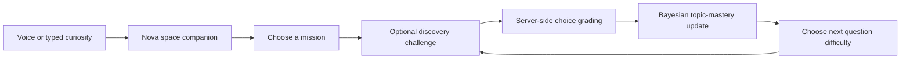

# Central Mind · A Voice-First Space Adventure for Kids

**Big questions. Cosmic adventures.** Meet Nova, a friendly astronomy companion: talk about planets, explore Saturn’s rings, investigate black holes, and try playful discovery challenges.

The experience is designed around curiosity, not an exam. Children can talk, type, tap a choice, ask for a hint, or skip the quiz. There are no timers, lost stars, leaderboards or penalties for a wrong answer.

## Play the Space Club

Python **3.10+**. The default clubhouse runs without API keys, cloud dependencies or package installation:

```bash
git clone https://github.com/divyeshparekh9496/Central-Mind.git
cd Central-Mind
python adventure_server.py
```

Open **http://127.0.0.1:8000**. Choose a destination, ask Nova a question, and try a little discovery challenge. The default guide is a limited, hand-authored astronomy collection, **not an unrestricted AI chatbot**.

| Destination | Adventure |
| --- | --- |
| Planet Hop | Find our home, meet Jupiter and discover orbits |
| Ring Detective | Investigate Saturn and its icy rings |
| Black Hole Lookout | Learn about light, gravity and the event horizon from a pretend safe spaceship |
| Star Explorer | Meet the Sun and discover where starlight comes from |

Each destination has three NASA-linked questions with hints and explanations. Discovery stars reward the first correct attempt on a question; incorrect answers never remove stars. Repeat practice does not repeatedly inflate mastery or rewards.

### Talk, listen or tap

- Press the microphone to ask a question; speech is converted to text by the browser and follows the same question route as typing.
- During a challenge, press **Say my answer** and say A, B, C, or the exact option text. The server grades the recognized choice.
- **Read it aloud** uses the browser’s text-to-speech. **Quiet mode** stops speech and listening.
- Voice depends on browser support and microphone permission. Typing and buttons remain available; recordings never start automatically.
- A grown-up can opt into connected research when using the configured cloud app. The local server explains when that mode is unavailable.

## Adaptive learning: Bayesian Knowledge Tracing

The child sees missions and discoveries. Underneath, **Bayesian Knowledge Tracing (BKT)** maintains a separate mastery estimate for each astronomy topic and guides question difficulty.



BKT is a probabilistic latent-knowledge model. It updates a prior mastery probability using whether an answer was correct, accounting for guessing and slips, then applies a learning transition. This implementation starts with prior **0.25**, learning probability **0.12**, guess probability **1/3**, and slip probability **0.10**. Quiz choices have three options.

**These parameters are configured assumptions, not fitted on children’s data.** No learning-outcome gains or validated child-development claims are made. The app performs Bayesian inference; fitting and evaluating the parameters on an appropriately collected dataset is future work. The estimate never appears as a high-stakes grade or public ranking.

[Implementation](services/adventure.py) · [BKT reference and training-library examples](https://github.com/CAHLR/pyBKT)

## What is stored

A random explorer session ID, per-topic mastery, question IDs and graded outcomes are stored in a local SQLite database under `data/`. The browser keeps its random ID in session storage. The adventure progress service does not store names, raw audio or free-form voice transcripts.

Browser speech providers may process audio online; the grown-up panel explains this before microphone use. **Delete this explorer’s progress** removes the active session’s quiz and mastery records. Server records otherwise remain until deleted. This is a development app, not a certified child-privacy or production deployment.

## Connected tutor and evidence-grounded RAG

The root FastAPI app serves the same clubhouse plus the existing connected research and astronomy tutor:

```bash
python -m venv .venv
source .venv/bin/activate
pip install -r requirements.txt
cp env.example .env
# Configure Google and AWS providers as needed.
python main.py
```

The local guide and quizzes still work in this app. Connected questions use NASA/arXiv evidence and the Nova tutor; research endpoints use Gemini. Nova’s prompt is now short, warm, age-aware and explicit about pretend adventures. A missing cloud configuration is reported instead of silently pretending that a live AI response was generated.

Research RAG includes live retrieval, SQLite passages, content hashes, citation alignment and configurable expiry. The root research/tutoring flows refresh when asked; they are not continuous monitors. The curated offline guide has NASA source links and a **review date of October 17, 2026**. It is not live-refreshed, and review dates are not publication dates.

The separate `astrovoice/` React app is an earlier interface. **The root Space Club is the primary kids’ experience**; its new adventure endpoints, BKT state and browser-voice path are not claimed to be installed in that separate app.

## Supporting ML experiment: evidence ranking

A trained supervised logistic evidence reranker and optional pretrained transformer cross-encoder support the research layer. This is a separate task from adapting quizzes. On 300 SciFact retrieval queries, BM25 scored nDCG@10 **0.6658**, compared with **0.6530** for the trained linear reranker; BM25 remains the stronger measured default. The cross-encoder has not been benchmarked here.

[Full RAG/ML report and limitations](docs/RAG_AND_ML.md) · [Raw results](docs/retrieval-evaluation.csv) · [Model](models/evidence_ranker.json)

## Verify

```bash
pip install -r requirements-ml.txt
# Research integration tests also need the lightweight web dependencies:
pip install python-dotenv httpx beautifulsoup4 lxml tenacity
python -m unittest discover -s tests -v
```

Tests cover the BKT update, adaptive question selection, topic isolation, repeated submissions, reward integrity, progress deletion, passage freshness and citation alignment. The offline server and browser-voice logic require no LLM API key. Live cloud generation and microphone playback need separate environment-specific checks.

## Project map

| Path | Purpose |
| --- | --- |
| `static/index.html` | Responsive Space Club, mission cards, optional voice and quizzes |
| `adventure_server.py` | Local, dependency-free clubhouse server |
| `services/adventure.py` | Mission content, deterministic grading, BKT and SQLite progress |
| `main.py` | Connected API plus matching `/adventure/*` endpoints |
| `services/nova_service.py` | Cloud voice/tutor integration and companion prompts |
| `services/rag/` | Evidence storage, retrieval and optional relevance reranking |
| `ml/` | Reproducible research-ranking experiments and retrieval CLI |

## Science and learning references

- [NASA solar system](https://science.nasa.gov/solar-system/)
- [NASA Saturn facts](https://science.nasa.gov/saturn/facts/)
- [NASA black holes](https://science.nasa.gov/universe/black-holes/)
- [NASA Sun facts](https://science.nasa.gov/sun/facts/)
- [pyBKT: Bayesian Knowledge Tracing](https://github.com/CAHLR/pyBKT)
