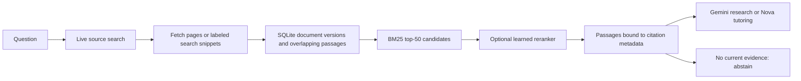

# RAG, ML choice and freshness

## Recommended technique

**Supervised evidence ranking** is the best-aligned learning task for this research assistant. It learns which passages are relevant to a question or claim. A **transformer cross-encoder** is a natural neural implementation because it reads query and passage jointly; it belongs after a fast first-stage retriever. The application supports this optional backend, but no custom cross-encoder fine-tuning or cross-encoder benchmark is claimed in this update.

A lightweight **pointwise logistic learning-to-rank** model is trained and included as a reproducible baseline. Features are BM25, IDF-weighted token-set cosine, query and title coverage, Jaccard overlap, bigram overlap, passage length and numeric-token overlap. Its score orders relevance; it is neither calibrated truth confidence nor an entailment prediction. BM25 itself is an unsupervised lexical retrieval algorithm.

This implements two-stage lexical retrieval plus optional supervised reranking. Dense bi-encoder retrieval, contextual embeddings, hybrid sparse/dense fusion and custom transformer fine-tuning are future experiments, not features we claim to have completed.

## Existing behavior and changes

The original root `/research` workflow already searched the web and put source text into a Gemini prompt: a basic form of web-grounded RAG. The original NASA/arXiv tutor also passed abstracts to a generator. They did not share a persistent passage index or a benchmarked relevance model.

The new root application workflow is:



Retrieval only passes positively matching candidates to a generator. It can still retrieve irrelevant material; the system does not guarantee factual correctness. Existing rule-based claim checks remain heuristic. The root `/chat` confidence field is retained for compatibility and labeled `uncalibrated_heuristic`, rather than treating a citation marker as 95% correctness.

## Measured baseline experiment

Dataset: [SciFact](https://github.com/allenai/scifact), distributed in [BEIR retrieval format](https://github.com/beir-cellar/beir). The corpus contains 5,183 scientific abstracts. Training uses 807 labeled queries after removing two normalized query texts overlapping the 300-query evaluation split. This text deduplication does not guarantee semantic/paraphrase independence. The corpus is shared between train and evaluation, as in corpus-retrieval benchmarks.

Regularization is selected using a grouped 20% split of the training queries (162 validation queries), then the selected linear model is refit on all remaining training queries. Training negatives are BM25 hard negatives plus random corpus negatives. Known positives may be inserted into **training** pairs; no positive documents are injected into evaluation candidates. Unjudged candidates are treated as nonrelevant, so incomplete judgments are a limitation.

| Model | MRR@10 | nDCG@10 | Recall@5 |
| --- | ---: | ---: | ---: |
| BM25 | 0.6340 | 0.6658 | 0.7226 |
| Trained logistic reranker | 0.6125 | 0.6530 | 0.7034 |

Both use the same BM25 top-50 pool, with candidate Recall@50 of 0.8751. The learned model **does not improve this baseline**. BM25 is therefore the default. The supervised artifact can be enabled with `RAG_MODEL_PATH=models/evidence_ranker.json`; a missing or incompatible explicit artifact fails instead of silently pretending to use ML.

These results evaluate **evidence relevance**, including both supporting and refuting abstracts. They do not measure factual answer quality, contradiction detection, freshness or performance on arbitrary websites. The labeled BEIR retrieval evaluation split is not SciFact's private claim-verification leaderboard. No live generation benchmark, cloud-provider call or cross-encoder experiment is included.

Evidence: [per-query CSV](retrieval-evaluation.csv), [summary, data checksum and artifact hash](retrieval-evaluation.json), [trained coefficients](../models/evidence_ranker.json).

## Reproduce

```bash
pip install -r requirements-ml.txt
python -m ml.download_scifact
python -m ml.train_ranker
python -m unittest discover -s tests -v
```

The archive and raw data stay under ignored `data/`. Training rewrites the model and evaluation reports. The dataset archive checksum, upstream download location and license attribution are recorded. SciFact claims/annotations are CC BY 4.0; abstracts are ODC-By 1.0 according to the [upstream license](https://github.com/allenai/scifact/blob/master/LICENSE.md). Cite Wadden et al., *Fact or Fiction: Verifying Scientific Claims* (2020), and Thakur et al., *BEIR* (2021), when using these data/results.

To run the optional neural backend:

```bash
pip install -r requirements-transformers.txt
# Downloads pretrained model weights on first startup.
export RAG_CROSS_ENCODER=cross-encoder/ms-marco-MiniLM-L6-v2
python main.py
```

This cross-encoder is pretrained elsewhere, not a model we trained here. Its web/scientific-domain performance needs measurement before preferring it to BM25. Published results from other organizations are not this repository's results.

## Keeping evidence current

- Root `/research` and `/chat` search sources on **every request**, bypassing old answer caches. This also prevents the old character-statistic cache from matching unrelated questions.
- Every extracted document records its retrieval time, canonical source URL, evidence kind and SHA-256 content hash. A page update replaces the entire indexed document, so old chunks disappear.
- Fetch time is **not** publication time. Publication dates remain unknown unless provided by the source API. arXiv candidates are requested in update-date order.
- Online generation can only read URLs refreshed during the current request. A failed refresh cannot silently reuse an older indexed copy. A live search snippet may be used and is explicitly labeled as a snippet.
- If no relevant current evidence is available, return an insufficient-evidence response rather than an unsupported generated answer.
- `/rag/search` and the local CLI search stored passages, applying `RAG_MAX_AGE_HOURS` (default 24) and returning timestamps. They do **not** perform a live refresh.

This is **request-time freshness**, not continuous monitoring. No background crawler, scheduled refresh service or guarantee of the newest world information is installed. Search engines and source APIs may lag, fail, or return old publications. Decorative source trust claims are not a substitute for measured verification.

These changes apply to the **root FastAPI app**. The separate `astrovoice/` application retains its own services and is not claimed to have this shared pipeline. Source text is treated as untrusted evidence in generation prompts; prompt instructions alone cannot guarantee immunity to malicious page content.

## Current references checked October 17, 2026

- [Sentence Transformers: retrieve and rerank](https://www.sbert.net/examples/sentence_transformer/applications/retrieve_rerank/README.html)
- [Sentence Transformers: reranking evaluation](https://www.sbert.net/docs/package_reference/cross_encoder/evaluation.html)
- [Anthropic: contextual retrieval](https://www.anthropic.com/engineering/contextual-retrieval) — supports combining lexical/semantic retrieval and reranking; its experiments are not our measurements.
- [Microsoft: freshness-aware retrieval](https://learn.microsoft.com/en-us/azure/search/agentic-retrieval-how-to-configure-freshness) — reinforces the need to track freshness explicitly rather than assume generated text is current.
